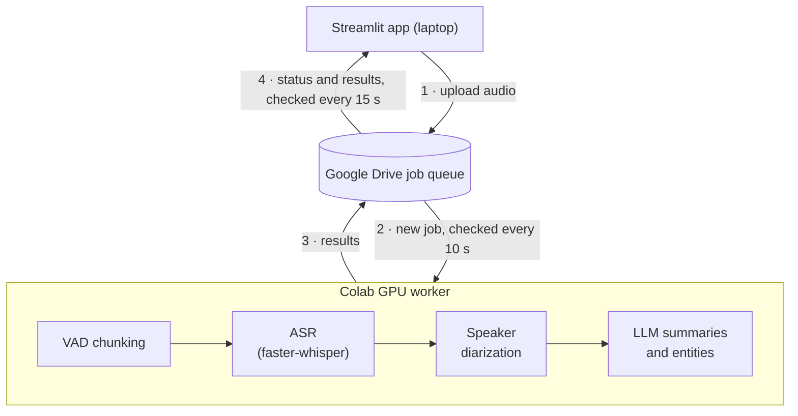

# AI Audio Assistant

A Python pipeline that takes a long audio file (podcast, lecture, meeting) and produces a speaker-labelled transcript, named entities, three levels of summary, timestamped chapters and a chat interface for asking questions about the recording. It was built as the course project for ECE22073. The goal was to process recordings longer than an hour on a free Colab GPU while keeping the user interface on a laptop, so the two halves talk through Google Drive instead of a server.

## Architecture



Where things live:

| Component | File |
|---|---|
| Streamlit app | `App/streamlit_app.py` |
| Drive access (upload, status, results) | `Pipeline/drive_bridge.py` |
| Colab worker loop | `Pipeline/colab_job_watcher.py`, started from `Pipeline/notebook.ipynb` |
| VAD chunking | `Pipeline/audio_processor.py` |
| ASR and speaker diarization | `Pipeline/asr_pipeline.py` |
| Optional extra ASR backends | `Pipeline/models_registry.py` |
| LLM steps | `Pipeline/llm_integration.py`, `Pipeline/transcript_normalizer.py`, `Pipeline/summary_generator.py` |
| Polling intervals and timeouts | `Pipeline/config.py` |

The Streamlit app only needs UI dependencies (no PyTorch). It uploads the audio to `ece22073/input/` on Drive, writes a `meta.json` with the selected ASR models to `ece22073/output/{job_id}/`, and polls `status.json` in that folder for progress. A Colab notebook (`Pipeline/notebook.ipynb`) installs the ML stack, mounts Drive and runs `colab_job_watcher.main_loop()`, which picks up new jobs, runs the pipeline and writes results to the same output folder. The watcher stops itself after 5 minutes without jobs. A job that has not updated its status for 10 minutes is shown as stalled.

## What the pipeline does

1. **Audio preparation** (`audio_processor.py`): loads any format via pydub/ffmpeg, normalizes loudness to -20 dBFS, resamples to 16 kHz mono, then uses Silero VAD to cut 25-30 s chunks at pauses of at least 0.5 s.
2. **Transcription** (`asr_pipeline.py`): faster-whisper `turbo` (float16 on CUDA, int8 on CPU) with language detection on each chunk. Each segment gets a confidence of `exp(avg_logprob)`; segments below 0.40 confidence or above 0.80 no-speech probability are marked unreliable.
3. **Speaker diarization**: `pyannote/speaker-diarization-3.1` runs on each speech chunk, and Whisper segments are assigned to speakers by time overlap.
4. **Live entity extraction** (`llm_integration.py`): every 120 s of transcribed audio, an LLM call is scheduled with `asyncio.create_task()` so it runs while ASR continues. Each call returns persons, organizations, keywords, main ideas and a one-sentence summary for that window.
5. **Transcript normalization** (`transcript_normalizer.py`): an LLM pass fixes proper nouns that ASR misspells across languages. The result is rejected if its length differs from the input by more than 15%, so the original transcript is kept when the model rewrites too much.
6. **Summaries** (`summary_generator.py`): four LLM calls run concurrently with `asyncio.gather()`: chapters with start times, TL;DR, executive summary and a structured deep dive (bullet points, takeaways, action items). The same module answers chat questions against the transcript.
7. **Model comparison** (`models_registry.py`): optionally re-transcribes the file with other ASR models so their output can be compared in the UI. The six registered backends are Whisper large-v3-turbo and Whisper large-v3 (faster-whisper), NVIDIA Parakeet TDT 0.6B v3 (Transformers), NVIDIA Canary 1B v2 and a NeMo Conformer-Transducer (NeMo), and Qwen2-Audio-7B-Instruct (Transformers). Extra models run one after another, and each one frees GPU memory before the next loads.
8. **Podcast generation** (`podcast_pipeline.py`, optional): an LLM writes a two-speaker script from the summary and a TTS model (Kokoro, Dia-1.6B, Bark, XTTS-v2 or F5-TTS) reads it out to an MP3.

The Streamlit app has five pages: Upload, Results (transcript, entities, chapters, summaries, chat), Accuracy (WER, CER, ROUGE and BLEU against a reference transcript you upload, via `App/comparison_metrics.py`), Podcast and History.

## Results

- **Accuracy:** 4.5% word error rate with Whisper Turbo on a 3-minute clean English clip.
- **Speed:** about 6× faster than real time on a Colab T4 GPU.

## Evaluation

The `Benchmarks/` folder contains the scripts used to measure the pipeline:

| Script | What it measures |
|---|---|
| `evaluate_real_pipeline.py` | WER (jiwer), summary ROUGE-1, topic recall and detected languages for the last pipeline run in `Results/`, against a `*_gt.json` ground-truth file |
| `benchmark_all.py` | runs Whisper turbo, Whisper large-v3, Parakeet and Canary on the same clip and compares them |
| `benchmark_parakeet.py`, `benchmark_canary.py` | the same for the NVIDIA models |
| `benchmark_no_vad.py` | plain Whisper on the whole file without VAD chunking |
| `benchmark_lang_lock.py` | forcing the detected language vs. auto-detection per chunk |
| `benchmark_normalize.py` | four transcript normalization variants and their effect on entity extraction, topic recall and summaries |

The test audio and ground-truth files are not in the repository, and neither are the result files, so there is no benchmark table here. To get numbers, place an audio file and a matching `<name>_gt.json` in `Samples/sample_podcasts/`, run the pipeline on it, then run the evaluation script (see below).

## Running it

### Requirements

- Python 3.11
- A Google Cloud project with the Drive API enabled and an OAuth 2.0 Desktop client (see [GOOGLE_CREDENTIALS_SETUP.md](GOOGLE_CREDENTIALS_SETUP.md))
- An OpenAI-compatible API key for the LLM steps
- A Hugging Face token with access to the gated `pyannote/speaker-diarization-3.1` model
- For the worker: a CUDA GPU. It was developed on a Colab T4. Parakeet, Canary and the NeMo model need CUDA.

Environment variables:

| Variable | Used for |
|---|---|
| `OPENAI_API_KEY` | all LLM calls |
| `HF_TOKEN` | pyannote and other gated Hugging Face models |
| `LLM_MODEL`, `LLM_BASE_URL` | optional: a different model or an OpenAI-compatible local server |

### 1. GPU worker (Colab)

1. Open `Pipeline/notebook.ipynb` in Colab and pick a T4 GPU runtime.
2. Add `OPENAI_API_KEY` and `HF_TOKEN` in the Colab Secrets panel.
3. Set the flags in the first cell (`INSTALL_PODCAST_DEPS`, `INSTALL_NEMO`) and run the cells in order. The last setup cell mounts Drive and starts the watcher.

The worker and the Streamlit app must use the same Google account, because both read and write the same `ece22073/` Drive folder.

### 2. Streamlit app (local)

```bash
git clone https://github.com/victorpolitakis/asr-notebook.git
cd asr-notebook
pip install -r App/requirements.txt
cp App/.env.example App/.env          # then set OPENAI_API_KEY
cp /path/to/your/credentials.json App/
cd App && streamlit run streamlit_app.py
```

On first launch, connect Google Drive from the sidebar. The OAuth token is cached in `App/token.json`. There is also a `Dockerfile` and `docker-compose.yml` in `App/` that run the same UI in a container.

### Running the pipeline without Drive

With the ML dependencies from `App/requirements_colab.txt` installed:

```bash
python Pipeline/run_pipeline.py path/to/audio.mp3      # writes to Results/
python Benchmarks/evaluate_real_pipeline.py            # needs Samples/sample_podcasts/<name>_gt.json
```

## Repository structure

```
App/
  streamlit_app.py         UI (single file)
  comparison_metrics.py    WER / CER / ROUGE / BLEU for the Accuracy page
  requirements.txt         UI-only dependencies
  requirements_colab.txt   ML dependencies for the worker
  Dockerfile, docker-compose.yml
Pipeline/
  notebook.ipynb           Colab entry point
  colab_job_watcher.py     polls Drive and dispatches ASR and podcast jobs
  drive_bridge.py          Google Drive API v3 wrapper
  config.py                Drive paths, polling intervals, job states
  run_pipeline.py          end-to-end pipeline for one file
  audio_processor.py       loading, loudness normalization, Silero VAD chunking
  asr_pipeline.py          faster-whisper transcription and pyannote diarization
  models_registry.py       the six ASR backends
  llm_integration.py       transcript accumulator and periodic LLM extraction
  transcript_normalizer.py LLM proper-noun correction
  topic_extraction.py      entity registry built from the extraction windows
  summary_generator.py     chapters, summaries, chat Q&A
  diarize_transcript.py, strip_newlines.py   output formatting for evaluation
  podcast_pipeline.py      script generation and TTS
Benchmarks/                evaluation and benchmark scripts
```

## Limitations

- Google Drive as a queue is simple but slow: job pickup and status updates depend on 10-15 s polling, and Colab sessions disconnect, so this is not meant for more than one user.
- The main pipeline always uses Whisper turbo with diarization. The other ASR models only produce a plain transcript of the whole file for comparison. They do not use the VAD chunking or diarization.
- Diarization runs per chunk, so speaker labels are not guaranteed to stay consistent across chunks.
- All summarization and entity extraction depends on an external LLM API, so results and cost depend on the model used.
- Sample audio, ground-truth transcripts and benchmark results are not included (see Evaluation).

## Credits

Course project for ECE22073, University of the Peloponnese, Spring 2026. Supervisor: Panagiotis Zervas. Written by Victor Politakis.
